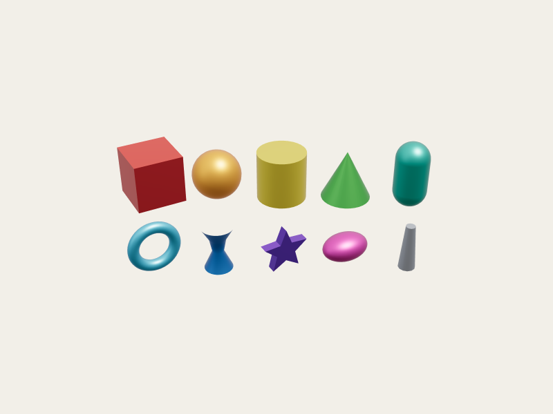
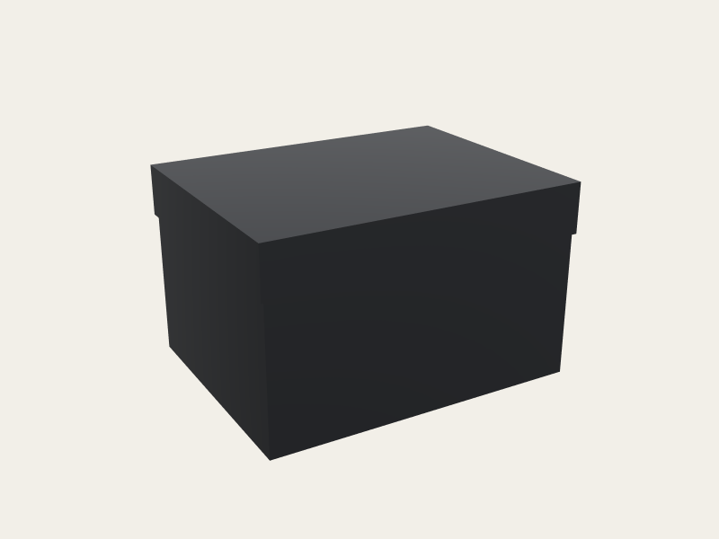
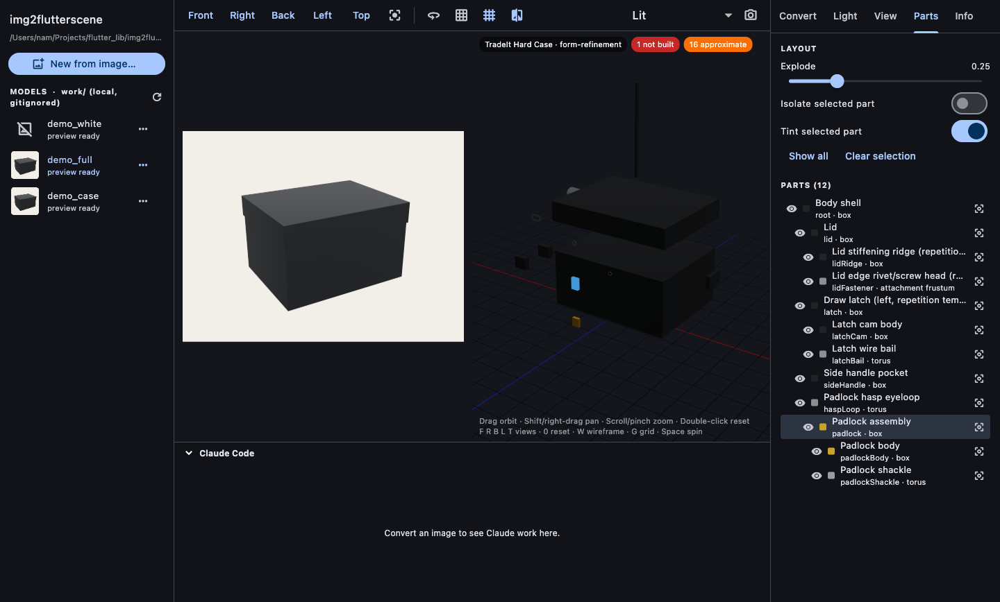
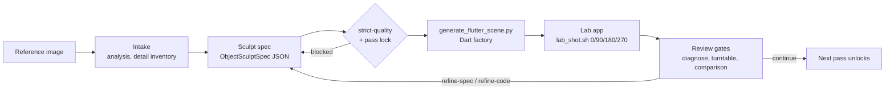

<div align="center">

# img2flutterscene

**Turn a reference image into a procedural 3D model for Flutter — written as Dart code, rendered by [flutter_scene](https://pub.dev/packages/flutter_scene).**

No mesh files. No textures. No downloaded art packs. Every part is generated geometry, built pass by
pass and checked against the reference image before the next pass unlocks.

[](LICENSE)
[](CHANGELOG.md)
[](https://flutter.dev)
[](https://pub.dev/packages/flutter_scene)
[](forge)
[](MIGRATION.md)




<sub>Left: the runtime's primitive gallery. Right: a model generated from a sculpt spec (blockout pass). Both are lab screenshots.</sub>

</div>

---

## Why

Games and apps built with Flutter can now draw real 3D through Flutter GPU and flutter_scene. Getting
*content* into them is still the hard part: you need an artist, a `.glb` pipeline, and an import
step to debug.

img2flutterscene takes the other route. The agent studies one reference image, writes a structured
**sculpt spec** (parts, proportions, materials, pivots), and a deterministic generator turns that spec
into a Dart factory. What you get:

- **Code you own.** A plain Dart function that builds the model. You can diff it, review it, and
  regenerate it from the spec.
- **Ready to animate.** Each part is its own node, named by its spec id and placed on its own pivot,
  so a lid opens about its hinge and a wheel spins about its axle.
- **Gated.** Strict spec validation, locked build passes, and screenshot review against the
  reference, so a result is never called "done" because it compiled.

## Quick look

```dart
import 'package:img2flutterscene/img2flutterscene.dart';
import 'models/treasure_chest.dart';           // generated from treasure-chest.spec.json

final chest = createTreasureChestModel();
scene.add(chest.node);                        // add .node, never .root (see "Coordinate frame")

chest.nodes['lid']!.rotation = eulerXyz(-0.9, 0, 0);   // open the lid about its own hinge
chest.explode(0.4);                                     // pull top-level parts apart
```

A generated factory reads like this. One block per spec component, with the sizes baked into the
geometry:

```dart
// lid — Lid (box)
{
  final pivot = Node(name: 'Lid__pivot')
    ..position = vm.Vector3(0.0, 0.31, 0.0)
    ..rotation = eulerXyz(0.0, 0.0, 0.0);
  nodes['root']!.add(pivot);
  nodes['lid'] = pivot;
  components['lid'] = SculptComponent(id: 'lid', name: 'Lid', role: 'hinge-lid', parent: 'root');
  final color = lin(0xFF212327);
  final b = PartBuilder()
    ..unitBox(color, seg: 12)
    ..scale(vm.Vector3(1.02, 0.16, 0.7956));
  pivot.add(Node(name: 'Lid', mesh: Mesh(b.build(), materials['shellMatte']!)));
}
```

## Desktop app



`tool/img2flutterscene_util` is a macOS companion that does the whole loop: **New from image… →
Convert**. It runs the skill through headless Claude Code, then lets you inspect the result live:

- an orbit camera (drag, pan, zoom, preset views);
- key light, ambient and exposure sliders;
- inspection views (face orientation for winding, normals, part colours, roughness), wireframe,
  and the reference beside the model or overlaid;
- a parts tree with isolate, focus and explode;
- vertices per part, and what the generator did **not** build.

```bash
cd tool/img2flutterscene_util && flutter run -d macos
```

Models you make live in `work/<id>/`, which is gitignored, so `git pull` never conflicts with your
own work. Details: [`tool/img2flutterscene_util/README.md`](tool/img2flutterscene_util/README.md).

## How it works



Passes run `blockout → structural → form → material → surface → lighting → interaction →
optimization`. Each pass adds detail levels (macro → meso → micro). Each one is captured in the lab,
compared with the reference, and recorded before the next is allowed. The Python `forge/` enforces
the rules, and the agent's vision does the judging. [`SKILL.md`](SKILL.md) is the full,
agent-facing order of operations.

## Quick start

**Requirements:** Flutter ≥ 3.47 (Dart 3.13) with Flutter GPU, Python ≥ 3.10, and macOS for the lab.

```bash
git clone https://github.com/BansookNam/img2flutterscene.git
cd img2flutterscene

# 1. Runtime package and lab app
(cd runtime && flutter pub get && flutter test)
(cd lab && flutter pub get && flutter run -d macos)     # Space spin · ←/→ angle · E explode

# 2. Generate a model from a spec (strict-quality and pass gates apply)
python3 forge/stage3_build/generate_flutter_scene.py lab/specs/sample_hard_case.json \
  --out lab/lib/models/sample_hard_case.dart --allow-partial --force

# 3. Capture the turntable views the review gates expect
scripts/lab_shot.sh sample_hard_case blockout 0,90,180,270 .lab-shots
```

### Use it as an agent skill

The repo is a skill for Claude Code / Codex / OpenCode. Link one checkout into each host, never a
copy:

```bash
ln -s "$PWD" ~/.claude/skills/img2flutterscene
ln -s "$PWD" ~/.codex/skills/img2flutterscene
```

Then give the agent an image: *"Rebuild this lantern as a flutter_scene model."*

### Use the runtime in your app

```yaml
dependencies:
  flutter_scene: ^0.24.3
  vector_math: ^2.4.3
  img2flutterscene:
    git:
      url: https://github.com/BansookNam/img2flutterscene.git
      path: runtime
```

Turn Flutter GPU on in your app the same way `lab/` does: `FLTEnableFlutterGPU` in the iOS/macOS
`Info.plist`, and `io.flutter.embedding.android.EnableFlutterGPU` in `AndroidManifest.xml`.

## What's supported

| | Status |
|---|---|
| Image intake, sculpt spec, strict validation, pass lock, local state checklist | ✅ inherited, unchanged |
| Primitives: box, sphere, ellipsoid, cylinder, cone, capsule, torus, lathe, extrude | ✅ |
| Parts spanning two attachment end points (limbs, rods) | ✅ |
| Hierarchy, pivots, explode, per-part metadata | ✅ |
| PBR materials (albedo, metalness, roughness) | ✅ |
| Lab: turntable, side-by-side with reference, scripted multi-angle capture | ✅ macOS |
| Live preview without compiling (`--format scene-json` + runtime loader) | ✅ |
| Desktop app: convert via Claude Code, orbit/light/inspection views, parts tree | ✅ macOS |
| Image review gates (diagnose, multi-angle, turntable, comparison sheet) | ✅ shared, take lab PNGs |
| Implicit SDF surfaces, sweeps, tubes | 🚧 runtime has the builders; generator not wired |
| Instancing, subdivision, bevels, deformations, vertex paint | 🚧 not ported |
| Rigging and animation | 🚧 not ported |

The generator never quietly swaps in a box for something it can't build. Unsupported parts **block**
generation; with `--allow-partial` it builds the rest and lists every omission at the top of the
generated file. [`MIGRATION.md`](MIGRATION.md) is the exact ledger and [`ROADMAP.md`](ROADMAP.md)
gives the order of work.

## Coordinate frame

Specs use three.js's frame: right-handed, +Y up, front +Z, and a character's own left at +X.
flutter_scene's world is **mirrored through Z** relative to that. `SculptModel.node` applies the
flip once (`scale(1, 1, −1)`, the same thing flutter_scene's glTF importer does), so left stays left.
Add `model.node` to your scene, and move or turn `node`. Never replace the frame node under it.
Details and the rest of the target's rules: [`grimoire/build/flutter_scene_target.md`](grimoire/build/flutter_scene_target.md).

## Repository layout

| Path | What |
|---|---|
| [`SKILL.md`](SKILL.md) | Agent-facing router: order of operations and hard rules |
| [`forge/`](forge) | Deterministic Python (stdlib): intake, spec, generators, review gates, state |
| [`forge/stage3_build/generate_flutter_scene.py`](forge/stage3_build/generate_flutter_scene.py) | Spec → Dart flutter_scene factory |
| [`runtime/`](runtime) | Dart package `img2flutterscene`: `PartBuilder`, unit primitives, `SculptModel` |
| [`lab/`](lab) | Flutter app for matching a model to its reference and capturing review shots |
| [`tool/img2flutterscene_util/`](tool/img2flutterscene_util) | macOS app: image → Convert (Claude Code) → live inspection |
| `work/` | Your models, one folder each. Local and gitignored |
| [`scripts/`](scripts) | `lab_shot.sh` (capture), `trace_silhouette.py` (silhouette trace + IoU) |
| [`grimoire/`](grimoire) | Routed reference material for each pipeline stage |
| [`MIGRATION.md`](MIGRATION.md) | What is ported, partial, or still three.js-only |

## Development

```bash
python3 -m unittest discover -s forge/tests -p 'test_*.py'
(cd runtime && flutter test && flutter analyze)
(cd lab && flutter analyze)
(cd tool/img2flutterscene_util && flutter test && flutter analyze)
```

With `flutter` on the PATH, the Python suite also **compiles generated Dart** against `runtime/`.
Set `IMG2FLUTTERSCENE_REQUIRE_FLUTTER=1` (as CI does) to make a missing Flutter a failure instead of
a skip. Contribution rules are in [`CONTRIBUTING.md`](CONTRIBUTING.md) and [`CLAUDE.md`](CLAUDE.md).

## Credits

- **[img2threejs](https://github.com/img2threejs/img2threejs)** (Apache-2.0): the staged sculpting
  pipeline, forge and grimoire this project migrates from three.js to flutter_scene.
- **[flutter_scene](https://pub.dev/packages/flutter_scene)**: the renderer.
- The `PartBuilder` geometry kit and silhouette tracer come from the Blue Heaven aquarium game.

Licensed under Apache-2.0. See [`LICENSE`](LICENSE) and [`NOTICE`](NOTICE).
